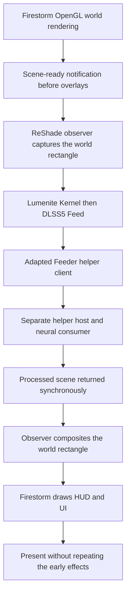

# DLSS5 integration: architecture, changelog and TODO

This Windows x64 developer preview processes Firestorm's world before UI and HUD
overlays, using the existing OpenGL renderer and the community ReShade/Feeder/
RenoDX stack. It does not use an official NVIDIA integration SDK. Text or signs
inside world textures remain part of the processed image.

## Architecture

### Viewer boundary

[The viewer patch](../indra/newview/fsscenesignal.h) provides a versioned C ABI,
`FirestormSceneReadyV1`, dispatched from `LLPipeline::renderFinalize()` after
the final world draw and before overlays. The packet describes the context,
scene/display serials, viewport, world rectangle, color/depth resources and
eligibility. Startup, disconnect, quit, snapshot and other auxiliary rendering
are distinguished from eligible main-world frames.

The viewer looks up the callback in an already loaded observer module. The
notification layer has no ReShade or NGX dependency; an absent observer is
supported. The observer validates the packet against the active GL context
before using borrowed resource identifiers.

### Early effects and composition

[The observer](../tools/dlss5-observer/early_neural.cpp) captures and resamples the
world into the existing client-sized effect domain, invokes ReShade's public
`render_effects` API for the selected Kernel/Feed chain, and copies the result
back only into the world rectangle. It handles GL orientation and preserves
touched state. Viewer overlay drawing follows that work.

The current early-chain guard accepts exactly one Lumenite Kernel and one
DLSS5 Feed, with no other enabled techniques. Enabling RTAO or any additional
technique makes early processing skip; the ordinary chain runs after overlays,
so DLSS5 can affect UI again too. Additional effects alongside protected early
processing are not supported by this preview.

The controller suppresses repetition of the early effects at ordinary
presentation and records duplicate witnesses. Resource and extent checks guard
execution. During startup, resize recovery or rejected frames, normal
presentation can still process overlays; sharp UI is established for settled
early processing, not every transition frame.

The current motion input comes from the configured community shader/provider
path (`DLSS5_MV_PROVIDER=3`), rather than viewer-generated object motion vectors.
The ABI exposes original scene depth metadata; that alone does not establish
correct color/depth/motion alignment for every content or rendering option.

### Helper process and resizing

[The adapted client](../tools/dlss5-observer/feeder_helper_restart.inc) is based on
official Feeder v1.19.0 (`3c09eab`) and identified as `1.19.0-fsresize1`. It uses
the unchanged official x64 helper host and existing synchronized transport. The
host loads the neural consumer and NVIDIA runtime outside the viewer process.
The two processes must use the same compatible GPU.

The consumer faulted when recreating its neural feature after size changes,
including with the original helper client. The workaround permits one GL
texture build per helper process. Any later build uses upstream's drain/close/
restart path to obtain a fresh process, including a same-size rebuild. Extents
settle for 250 ms, and stale-size build results are rejected.

This bypasses the observed recreation fault; it does not repair consumer
internals. In the tested resize cycle it caused about four seconds of pause and
roughly eight seconds before neural output returned.

### Installation and distribution

The [installer and launcher](../tools/dlss5-observer/PACKAGE-README.md) verify
package/component hashes, require the patched viewer, temporarily swap the
helper stack and preserve the working RHI configuration. Normal use starts
`Launch-FirestormNeural.cmd` in the viewer folder with the normal profile. Its
console must remain open until normal exit restores the original settings and
add-ons. Interrupted sessions have a documented recovery procedure.

The manual [GitHub Actions workflow](../.github/workflows/dlss5-windows-preview.yml)
builds two downloads: an unsigned OpenAL/OpenJPEG viewer installer and an
integration bundle with a separate helper folder and license notices. The
integration ZIP includes sources, a viewer patch, the observer and scripts.
ReShade, the neural consumer, NVIDIA runtimes/models and user configuration are
obtained separately. Only curated public documentation is packaged; private
planning notes and raw experiment evidence are excluded. Artifacts expire after
30 days. See the [download guide](../tools/dlss5-observer/CI-DOWNLOAD-README.md).

## Changelog

### 2026-10-22 — Initial integration preview

- Added the optional viewer notification ABI and explicit main-world eligibility.
- Added early Kernel/Feed execution, world-rectangle composition, GL orientation/
  state handling and present-time duplicate suppression to preserve settled UI.
- Removed continuous per-draw discovery from the normal early-neural path.
  In one fixed-size scene, 3,517 early compositions completed with zero duplicate
  Feed calls, a settled 1:1 evaluation/present ratio and about 45 FPS. This is a
  single-scene result, not a general performance guarantee.
- Added helper restart recovery after the in-process and original helper routes
  failed size-changing consumer recreation. The adapted route passed one
  1920x1111 → 1006x691 → 1920x1111 cycle, with actual neural evaluation at all
  three sizes in separate helper processes, 2,411 early compositions, zero
  duplicate Feed calls, normal viewer exit and baseline restoration.
- Added hash-verified installation, launch, recovery and removal scripts, portable
  helper manifests, source packaging and manual Windows CI downloads.
- Verified a hosted full viewer build and package download. It took about
  80 minutes. Seven hosted integration checks passed; two native OpenGL checks
  were skipped because the runner lacked the required context. All nine checks
  passed locally. Downloaded hashes and isolated package installation,
  preparation, restoration and rejection checks passed without launching a viewer.

User observation confirmed sharp UI/HUDs and working neural output during the
development runs. Automated counts and CI success do not establish image quality
or neural rendering on a fresh installation. The superseded in-process v0.8
resize preview should not be distributed as the working helper route.

## TODO and known limits

- Support selected additional world effects, such as RTAO, before overlay drawing
  with explicit ordering and resource/state checks. The current two-technique
  guard must not simply be removed without validating the expanded chain.
- Verify the downloadable viewer and integration on a fresh install, including
  normal-profile use, component compatibility and hybrid-GPU selection.
- Exercise repeated resize dragging, minimize/restore, device/context loss,
  disconnect/reconnect, shader reload, snapshots and longer sessions. Measure
  memory/resource retention and helper shutdown across repeated restarts.
- Reduce resize interruption and investigate the consumer recreation fault when
  suitable source or supported integration hooks become available.
- Evaluate camera pans, animated avatars, transparency, water, world text,
  alternate viewports and graphics settings. Check guide alignment and motion
  quality before considering engine-generated motion vectors.
- Improve failure/recovery diagnostics and measure comparable-scene performance
  across more hardware. A helper's evaluation/present ratio describes its own
  window, so it must not be treated as the viewer's frame ratio.
- Validate the existing Feeder host-settings mirror and improve persistent
  synchronization with the viewer baseline. Its Apply button writes the host INI
  and restarts the helper; changes are not instantaneous or copied back to the
  baseline, which is used to regenerate host settings next launcher session.
- Verify dependency redistribution terms before broader releases, and consider
  signed installers and durable release downloads after fresh-install checks.

The tested baseline is ReShade 6.8.0, Feeder 1.19.0, RenoDX consumer 8.5.0-rc10
and Lumenite Kernel 2026.10.17. Use Generic Depth enabled, Match resolution exactly,
copy-before-clears off, provider 3, one Kernel followed by one Feed, one neural
pass, Upscaled hook, style 0 and neural upscaling off. Version changes need their
own verification. Official SDK access can be reassessed later; a Vulkan renderer
port is not a prerequisite for this approach.
